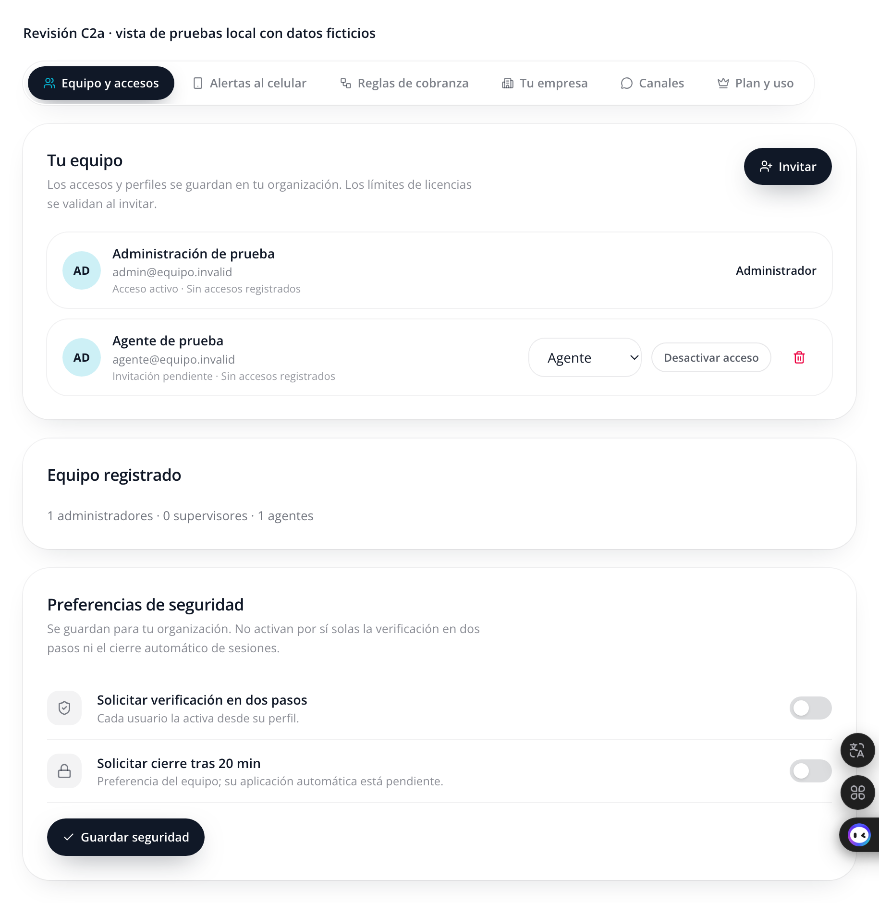

# C2a — Equipo, seguridad y reglas persistentes

Primera parte de C2, en `codex/c2-persistencia`, desde `main` actualizado tras
fusionar C1. No trae migración ni cambios al esquema de Prisma.

## Qué se guarda y dónde

| Sección | Fuente y escritura |
| --- | --- |
| Equipo y accesos | `GET /users`, `POST /users/invite`, `PATCH /users/:id`, `PATCH /users/:id/status`, `DELETE /users/:id` |
| Preferencias de seguridad | `Organization.settings.collectionSecurity` (`dosPasos`, `inactividad`) |
| Preferencias de reglas | `Organization.settings.collectionRules` (`festivos`, `descuentoMax`, `parcialidades`, `prorroga`, `aprueba`) |
| Hora de envío | `collectionEngineHour`, con su conexión existente; no hay otra copia |
| Máximo de mensajes | `CollectionPolicy.maxContactsPerWeek`, por `PATCH /collection-policies/:id` |
| Días con mensajes | `CollectionPolicy.blackoutDates`, por el mismo endpoint |

Las preferencias nuevas tienen defaults conservadores, validación al leer,
validación del parche y DTOs anidados. No se importan valores del navegador:
las claves antiguas no tienen organización ni dueño verificables. Al fallar la
carga, no se guardan defaults sobre la organización ni se inventan usuarios.

El guardado de settings usa `withOrg`, filtra la organización y bloquea su fila
durante la transacción. Conserva claves existentes fuera de `OrgSettings`, como
`product`, licencias y otras secciones. Los parches de `SettingsService` se
serializan para que guardar reglas y seguridad a la vez no pierda uno de los cambios.

Los usuarios, estados y últimos accesos vienen de la API. La invitación respeta
el contrato real `{ user, inviteLink, emailSent }`; no afirma que se envió correo
si el backend informa que no se envió. La reasignación antes de eliminar usa IDs
reales, no nombres. Si falla alguna reasignación no se elimina el acceso; las
reasignaciones ya confirmadas permanecen y el reintento consulta la cartera de nuevo.
Los selectores de agentes se refrescan tras cambios en el equipo.

Se retiraron el equipo inventado y los números de ejemplo de licencias/consumo
en “Plan y uso”. Esa vista muestra el conteo real del equipo y “Sin datos” para
licencias y consumo, porque no dispone de una consulta de esos datos.

## Calendario y límites de alcance

`blackoutDates` contiene fechas concretas, no recurrencias semanales. Guardar los
días con mensajes genera exclusiones para **365 días** en la zona de la política.
La pantalla advierte que el calendario debe renovarse antes de vencer. No se
crea una copia de los días en settings ni un cron nuevo.

Para recuperar la selección, un día se muestra bloqueado si todas sus fechas
de las próximas cuatro semanas están excluidas. Un festivo aislado no apaga todo
un día de la semana. Se conservan exclusiones puntuales y fechas futuras fuera del
periodo; se retiran fechas ya pasadas para permitir renovar el calendario.
Al habilitar un día antes bloqueado se retiran sus exclusiones dentro del periodo;
la pantalla lo indica. Si la combinación supera 366 fechas, límite del endpoint,
se muestra un error antes de enviar el parche.

Las preferencias de seguridad se **persisten**; no implementan una obligación
de 2FA por organización ni un temporizador de cierre de sesión. La verificación
en dos pasos existente la activa cada usuario en su perfil. Tampoco se incorpora
en este PR la aplicación automática de descuentos, prórrogas o festivos: se
registran las preferencias y la pantalla evita afirmar que ya se aplican.

## Cómo probar

Con una API local o de staging y una sesión de administrador de organización:

1. Abre Cobranza → Configuración → Equipo y accesos. Comprueba que coincide con
   `GET /users`; si no hay datos o la API falla, no aparece la lista de ejemplo.
2. Invita una cuenta de prueba, cambia el perfil supervisor/agente y desactiva
   su acceso. Recarga y comprueba los mismos valores en otro navegador.
3. Para eliminar un agente con clientes, elige un agente activo de destino.
   Comprueba la reasignación en la cartera y la eliminación en `GET /users`.
4. Cambia seguridad y pulsa “Guardar seguridad”. Vuelve a abrir la pestaña o
   inicia otra sesión de la misma organización: los valores se conservan.
5. En Reglas, guarda preferencias con “Guardar reglas”. Guarda días y máximo
   con “Guardar calendario y límite”; verifica `blackoutDates` y
   `maxContactsPerWeek` en la política. Si falta un plan, se ofrece crearlo con
   aprobación manual; no se crea por abrir la pantalla.
6. Cambia Hora de envío: la petición sigue siendo únicamente el parche de
   `collectionEngineHour`. Revisa que otra organización conserve su configuración.
7. Simula fallos de lectura/escritura: los borradores se conservan y no se anuncia
   éxito. Un error de carga de reglas no deja guardar valores por defecto.

Las pruebas de Jest/Vitest cubren casos felices y de error, recuperación tras
recarga, calendario en distintas zonas, permisos de campos y errores sin éxito falso.
También se añadió la prueba del flujo principal exigida en cada PR: factura
vencida → sombra sin envío → importación y propuesta de abono → freno por depósito
sin revisar → confirmación única → factura `PAID` excluida del motor. Usa servicios
reales con mocks de base de datos, sin red.

Se comprobó además en PostgreSQL 16 temporal, con un rol sin superusuario ni
`BYPASSRLS`, que tres parches concurrentes conservan reglas, seguridad, hora,
producto y licencias; un parche inválido no escribe y otra organización queda
intacta. Se revisaron las pantallas en Chrome con datos ficticios y se retiró la
página temporal de revisión.

Captura de Equipo y Seguridad (datos de prueba, no una cuenta real):

## Segundo PR pendiente (C2b)

Falta migrar alertas, destinatarios, no molestar, resumen, empresa, reportes
guardados y el estado persistido de `store.tsx`. Este primer PR no da por terminada
C2 ni elimina todavía todos los usos de `localStorage` de Cobranza. El segundo
PR partirá de `main` actualizado tras integrar esta base. C3 espera visto bueno.
